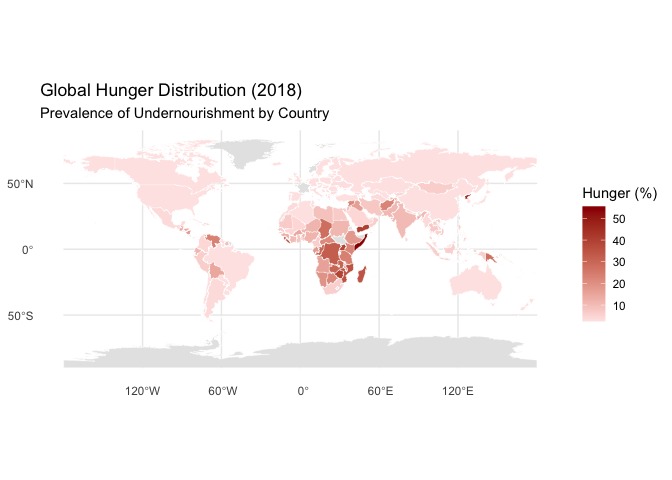
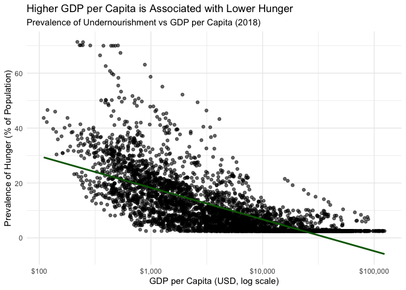
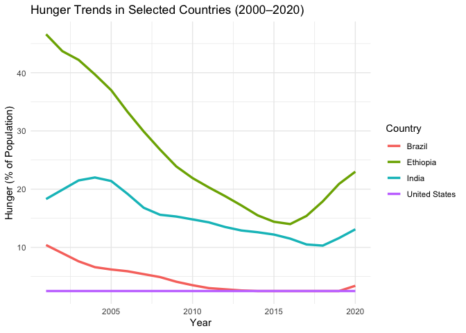

# Understanding Global Hunger: Inequality, Education and Wealth

An exploratory analysis in R of how hunger (prevalence of undernourishment) relates to income inequality, primary school enrolment and GDP per capita across countries, using World Bank data from 2000 to 2020.

> **University project:** QUT, MXB262 Visualising Data, Semester 1 2025 (Final Project). Individual work.

**Read the full report:** [`report/global_hunger_analysis.md`](report/global_hunger_analysis.md) (renders on GitHub) · [PDF](report/global_hunger_analysis.pdf)



## Problem

Wealthier countries tend to have less hunger, but how much do economic and social factors actually explain? The report asks three questions:

1. How strongly is hunger associated with income inequality (GINI index), primary school enrolment and GDP per capita?
2. Which factor matters most?
3. How has hunger changed over time, and where are the exceptions?

## Data

Four World Bank indicators, as annual country-level values for 2000–2020:

| Indicator | Code | File |
|---|---|---|
| Prevalence of undernourishment (% of population) | `SN.ITK.DEFC.ZS` | `data/API_SN.ITK.DEFC.ZS_DS2_en_csv_v2_2561.csv` |
| GINI index (income inequality) | `SI.POV.GINI` | `data/API_SI.POV.GINI_DS2_en_csv_v2_2566.csv` |
| Primary school enrolment (% gross) | `SE.PRM.ENRR` | `data/API_SE.PRM.ENRR_DS2_en_csv_v2_5690.csv` |
| GDP per capita (current US$) | `NY.GDP.PCAP.CD` | `data/API_NY.GDP.PCAP.CD_DS2_en_csv_v2_2702.csv` |

**Source:** [World Bank, World Development Indicators](https://data.worldbank.org/) (files last updated 5 June 2025). Licensed under [CC BY 4.0](https://datacatalog.worldbank.org/public-licenses#cc-by). The original CSV downloads are included unchanged in `data/`.

## Approach

1. **Cleaning and reshaping**
   - Kept the 2000–2020 columns.
   - Pivoted each indicator from wide to long format (`Country`, `Year`, `Value`).
   - Joined the four indicators on country name, ISO code and year.
2. **Data availability check.** Counted missing values by indicator and by year. GINI is reported by far fewer countries (under 100 per year) than hunger, GDP or enrolment, so any comparison involving inequality covers fewer, mostly wealthier countries.
3. **Exploratory analysis.** Summary statistics and distributions for 2018, the most recent year with the best coverage. GDP is heavily right-skewed, so the plots use a log scale for it.
4. **Visualisation**
   - Scatter plots with linear trend lines for each factor against hunger
   - A global trend line
   - Country trends for Brazil, Ethiopia, India and the United States
   - A choropleth world map for 2018
5. **Correlation tests.** Pearson correlation tests between each factor and hunger.

## Key results

**2018 cross-country averages:**

| Indicator | Mean | SD |
|---|---|---|
| Hunger prevalence | 9.7% | 9.7 |
| GINI index | 35.7 | 6.6 |
| Primary enrolment (gross) | 101.1% | 9.9 |
| GDP per capita | US$17,589 | US$25,945 |

**Correlation with hunger.** Pearson's r, using all country-year observations from 2001 to 2020:

| Factor | r | Observations | p |
|---|---|---|---|
| GDP per capita | −0.43 | 4,342 | < 0.001 |
| GINI index | 0.40 | 1,513 | < 0.001 |
| Primary school enrolment | −0.07 | 3,837 | < 0.001 |

- **Strongest factors:** GDP per capita and income inequality have the strongest associations with hunger. School enrolment has almost none.
- **Where hunger is concentrated:** mainly sub-Saharan Africa, with several countries above 30% and some above 50% in 2018. Several countries, mostly in Africa and Asia, have no data at all.
- **Progress can reverse:**
  - Ethiopia cut undernourishment from 46.6% (2001) to about 14% (2016), then it rose to 23.0% by 2020.
  - India fell from a peak of 22.0% (2004) to 10.3% (2018), then rose to 13.1%.
  - Brazil fell from 10.4% to 2.5%, while the United States stayed flat at 2.5%.

| GDP per capita vs hunger | Hunger trends in selected countries |
|---|---|
|  |  |

## Tools

R · tidyverse (readr, dplyr, tidyr, ggplot2) · sf · rnaturalearth · naniar · R Markdown

## How to run

1. Install R (4.4 or later) and, for the PDF, a LaTeX distribution such as [TinyTeX](https://yihui.org/tinytex/).
2. Install the packages:
   ```r
   source("install_packages.R")
   ```
3. Knit `global_hunger_analysis.Rmd` in RStudio, or run this from the project folder:
   ```r
   rmarkdown::render("global_hunger_analysis.Rmd", output_dir = "report")
   ```

The Rmd reads the CSV files from `data/` using relative paths, so run it from the repository root. `session_info.txt` lists the package versions used for the last render.

## What I'd improve next

- **Use one year consistently.** The scatter plots and correlation tests use every year from 2001 to 2020 pooled together, although their subtitles say 2018. I'd filter to 2018 (or average each country over a period) so every point is one country.
- **Remove World Bank aggregates.** The CSVs also contain regional and income-group rows such as "World", "Sub-Saharan Africa" and "High income". I'd drop them so only countries are analysed.
- **Account for the 2.5% reporting floor.** The World Bank reports undernourishment below 2.5% as 2.5. That floor shows up as a flat line of points in the GDP chart, and it weakens the linear fit.
- **Go beyond pairwise correlation.** Fit a multiple regression with log GDP, GINI and enrolment together to see which factor still matters once the others are controlled for, and use Spearman correlation for the skewed variables.
- **Handle missing GINI data.** GINI is missing for many low-income countries, so I'd test how sensitive the results are to that, for example by comparing countries with and without GINI data.
- **Build the interactive version.** The report proposes a scrolling, interactive map. I'd build it with Shiny or Plotly.

## Repository structure

```
.
├── README.md
├── global_hunger_analysis.Rmd      # analysis and report source (R Markdown)
├── data/                           # World Bank CSV downloads (CC BY 4.0)
├── report/
│   ├── global_hunger_analysis.md   # rendered report for GitHub
│   ├── global_hunger_analysis.pdf  # rendered PDF report
│   └── global_hunger_analysis_files/figure-gfm/   # charts
├── install_packages.R              # installs the required R packages
└── session_info.txt                # R and package versions used to render
```
