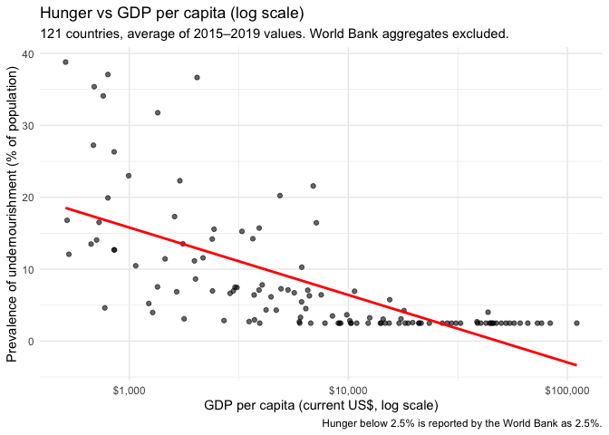
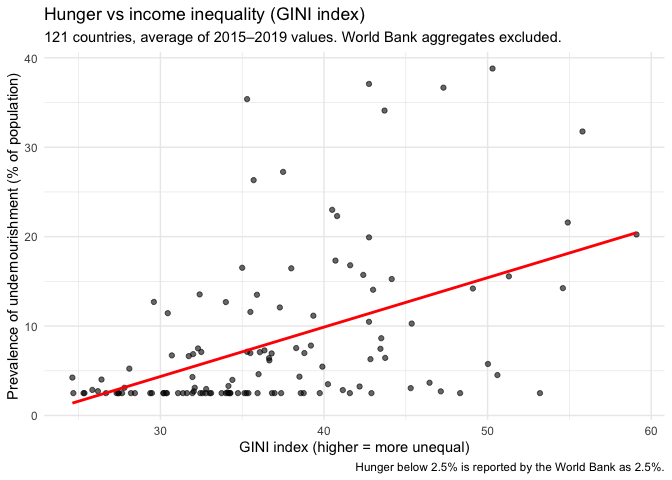

# Understanding Global Hunger: Inequality, Education and Wealth

An exploratory analysis in R of how hunger (prevalence of undernourishment) relates to income inequality, primary school enrolment and GDP per capita across countries, using World Bank data from 2000 to 2020.

> **University project:** QUT, MXB262 Visualising Data, Semester 1 2025 (Final Project). Individual work.

**Read the reports** (both render on GitHub):
- **v1, as submitted:** [`report/global_hunger_analysis.md`](report/global_hunger_analysis.md) · [PDF](report/global_hunger_analysis.pdf)
- **v2, a revised analysis:** [`report/global_hunger_analysis_v2.md`](report/global_hunger_analysis_v2.md). It uses one point per country (121 countries, 2015–2019 averages), removes World Bank aggregates, and adds log GDP and Spearman correlations. See [v2 results](#v2-results-one-point-per-country).


## Problem

Wealthier countries tend to have less hunger, but how much do economic and social factors actually explain? The report asks three questions:

1. How strongly is hunger associated with income inequality (GINI index), primary school enrolment and GDP per capita?
2. Which factor matters most?
3. How has hunger changed over time, and where are the exceptions?

## Data

Four World Bank indicators, as annual country-level values for 2000–2020:

| Indicator | Code | File |
|---|---|---|
| Prevalence of undernourishment (% of population) | `SN.ITK.DEFC.ZS` | `data/API_SN.ITK.DEFC.ZS_DS2_en_csv_v2_2561.csv` |
| GINI index (income inequality) | `SI.POV.GINI` | `data/API_SI.POV.GINI_DS2_en_csv_v2_2566.csv` |
| Primary school enrolment (% gross) | `SE.PRM.ENRR` | `data/API_SE.PRM.ENRR_DS2_en_csv_v2_5690.csv` |
| GDP per capita (current US$) | `NY.GDP.PCAP.CD` | `data/API_NY.GDP.PCAP.CD_DS2_en_csv_v2_2702.csv` |

**Source:** [World Bank, World Development Indicators](https://data.worldbank.org/) (files last updated 5 June 2025). Licensed under [CC BY 4.0](https://datacatalog.worldbank.org/public-licenses#cc-by). The original CSV downloads are included unchanged in `data/`.

v2 also uses the World Bank's **country metadata file** (`data/Metadata_Country_API_NY.GDP.PCAP.CD_DS2_en_csv_v2_2702.csv`), from the same download. It gives each economy its region and income group. Aggregate rows such as "World" or "High income" have no region, which is how v2 finds and removes them.

## Approach

1. **Cleaning and reshaping**
   - Kept the 2000–2020 columns.
   - Pivoted each indicator from wide to long format (`Country`, `Year`, `Value`).
   - Joined the four indicators on country name, ISO code and year.
2. **Data availability check.** Counted missing values by indicator and by year. GINI is reported by far fewer countries (under 100 per year) than hunger, GDP or enrolment, so any comparison involving inequality covers fewer, mostly wealthier countries.
3. **Exploratory analysis.** Summary statistics and distributions for 2018, the most recent year with the best coverage. GDP is heavily right-skewed, so the plots use a log scale for it.
4. **Visualisation**
   - Scatter plots with linear trend lines for each factor against hunger
   - A global trend line
   - Country trends for Brazil, Ethiopia, India and the United States
   - A choropleth world map for 2018
5. **Correlation tests.** Pearson correlation tests between each factor and hunger.

## Key results (v1, as submitted)

**2018 cross-country averages:**

| Indicator | Mean | SD |
|---|---|---|
| Hunger prevalence | 9.7% | 9.7 |
| GINI index | 35.7 | 6.6 |
| Primary enrolment (gross) | 101.1% | 9.9 |
| GDP per capita | US$17,589 | US$25,945 |

**Correlation with hunger.** Pearson's r, using all country-year observations from 2001 to 2020:

| Factor | r | Observations | p |
|---|---|---|---|
| GDP per capita | −0.43 | 4,342 | < 0.001 |
| GINI index | 0.40 | 1,513 | < 0.001 |
| Primary school enrolment | −0.07 | 3,837 | < 0.001 |

- **Strongest factors:** GDP per capita and income inequality have the strongest associations with hunger. School enrolment has almost none.
- **Where hunger is concentrated:** mainly sub-Saharan Africa, with several countries above 30% and some above 50% in 2018. Several countries, mostly in Africa and Asia, have no data at all.
- **Progress can reverse:**
  - Ethiopia cut undernourishment from 46.6% (2001) to about 14% (2016), then it rose to 23.0% by 2020.
  - India fell from a peak of 22.0% (2004) to 10.3% (2018), then rose to 13.1%.
  - Brazil fell from 10.4% to 2.5%, while the United States stayed flat at 2.5%.

| GDP per capita vs hunger | Hunger trends in selected countries |
|---|---|
|  |  |

The v1 correlations pool every year from 2001 to 2020 and include World Bank aggregate rows. v2 below corrects both.

## v2 results: one point per country

[`global_hunger_analysis_v2.Rmd`](global_hunger_analysis_v2.Rmd) revisits the correlations. v1 is left unchanged. What changed:

- **Aggregates removed.** 48 World Bank aggregate rows ("World", regions, income and lending groups) and one "Not classified" row are dropped, using the country metadata file. That leaves 217 economies.
- **One point per country.** Each indicator is averaged over 2015–2019 for each country, and only countries with all four indicators are kept: **121 countries**.
  - I compared this with using 2018 only, which keeps 88 countries but only 6 low-income ones, against 13 with the average. Hunger is concentrated in low-income countries, so I used the average.
  - The trade-off: values can come from different years, and 37 countries have only one GINI value in the period.
- **Log GDP and Spearman.** Pearson's correlation uses log10 GDP, because GDP is heavily skewed. Spearman's rank correlation is added as a robustness check.
- **Honest plot labels.** Titles describe what is plotted, and every subtitle gives the number of countries and the years used.

**v1 vs v2: correlation with hunger**

| Factor | v1 r | v1 p | v1 n | v2 Pearson r | v2 p | v2 Spearman ρ | v2 p | v2 n |
|---|---|---|---|---|---|---|---|---|
| GDP per capita | −0.431 (raw GDP) | < 2.2e-16 | 4,342 | **−0.669** (log GDP) | 4.8e-17 | **−0.828** | 1.0e-31 | 121 |
| GINI index | 0.405 | < 2.2e-16 | 1,513 | **0.474** | 4.0e-08 | **0.507** | 3.0e-09 | 121 |
| Primary school enrolment | −0.071 | 1.2e-05 | 3,837 | 0.128 | 0.16 | −0.026 | 0.78 | 121 |

v1's n counts **country-years** (2001–2020, aggregates included). v2's n counts **countries**.

- **GDP per capita** has the strongest relationship with hunger in v2. Spearman's ρ is stronger than Pearson's r because hunger falls steadily with GDP but not along a straight line. Part of the reason is the floor: the World Bank reports undernourishment below 2.5% as 2.5%, and 45 of the 121 countries sit exactly at that floor.
- **Income inequality (GINI)** has a moderate positive relationship with hunger, slightly stronger than in v1.
- **Primary school enrolment** shows no relationship in v2 (p = 0.16 and 0.78), and the two methods don't even agree on its direction.
  - v1's significant result (p ≈ 1e-5) came from treating 3,837 country-year observations as independent.
  - Repeated observations of the same countries make a near-zero correlation look significant.
- **These are correlations, not causes.**

| Hunger vs GDP per capita (log scale), v2 | Hunger vs income inequality, v2 |
|---|---|
|  |  |

## Tools

R · tidyverse (readr, dplyr, tidyr, ggplot2) · sf · rnaturalearth · naniar · R Markdown

v2 uses only dplyr and ggplot2, plus base R for reading the files and running the correlation tests.

## How to run

1. Install R (4.4 or later) and, for the PDF, a LaTeX distribution such as [TinyTeX](https://yihui.org/tinytex/).
2. Install the packages:
   ```r
   source("install_packages.R")
   ```
3. Knit `global_hunger_analysis.Rmd` (v1) in RStudio, or run this from the project folder:
   ```r
   rmarkdown::render("global_hunger_analysis.Rmd", output_dir = "report")
   ```
4. For v2, knit `global_hunger_analysis_v2.Rmd`. To produce the GitHub version in `report/`:
   ```r
   rmarkdown::render("global_hunger_analysis_v2.Rmd", output_format = "github_document", output_dir = "report")
   ```

The Rmd reads the CSV files from `data/` using relative paths, so run it from the repository root. `session_info.txt` lists the package versions used for the last render.

## What I'd improve next

- **Done in v2:**
  - one point per country (2015–2019 averages)
  - World Bank aggregates removed
  - log GDP, and Spearman correlations as a robustness check

  See [v2 results](#v2-results-one-point-per-country).
- **Account for the 2.5% reporting floor.** The World Bank reports undernourishment below 2.5% as 2.5, and 45 of v2's 121 countries sit exactly at that floor. I'd treat those values as censored ("2.5% or less") instead of exact.
- **Go beyond pairwise correlation.** Fit a multiple regression with log GDP, GINI and enrolment together, to see which factor still matters once the others are accounted for. As a first step, check how strongly GDP and GINI are correlated with each other.
- **Handle missing GINI data.** GINI is missing for many low-income countries, so I'd test how sensitive the results are to that, for example by comparing countries with and without GINI data.
- **Build the interactive version.** The report proposes a scrolling, interactive map. I'd build it with Shiny or Plotly.

## Repository structure

```
.
├── README.md
├── global_hunger_analysis.Rmd        # v1: analysis and report source (R Markdown), as submitted
├── global_hunger_analysis_v2.Rmd     # v2: revised analysis (one point per country)
├── data/                             # World Bank CSV downloads + country metadata (CC BY 4.0)
├── report/
│   ├── global_hunger_analysis.md     # v1 rendered for GitHub
│   ├── global_hunger_analysis.pdf    # v1 rendered PDF
│   ├── global_hunger_analysis_files/figure-gfm/      # v1 charts
│   ├── global_hunger_analysis_v2.md  # v2 rendered for GitHub
│   └── global_hunger_analysis_v2_files/figure-gfm/   # v2 charts
├── install_packages.R              # installs the required R packages
└── session_info.txt                # R and package versions used to render
```
