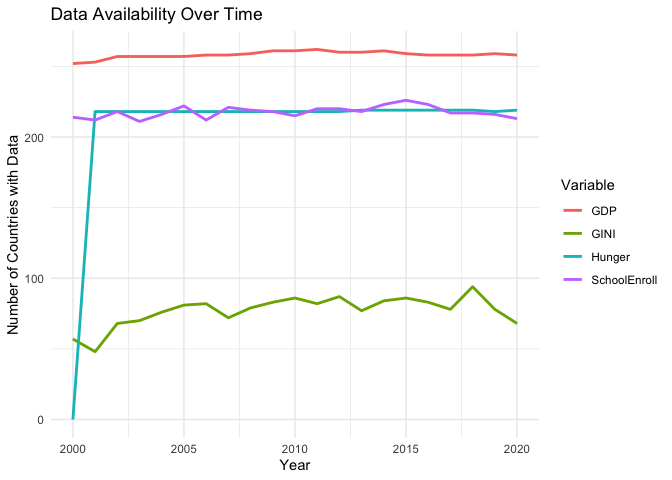
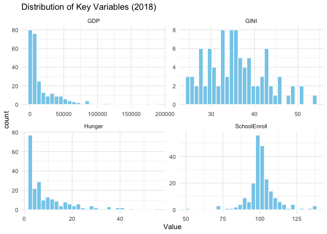
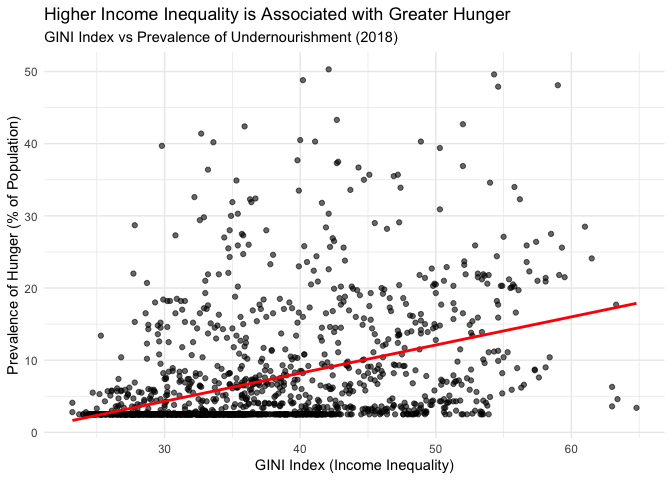
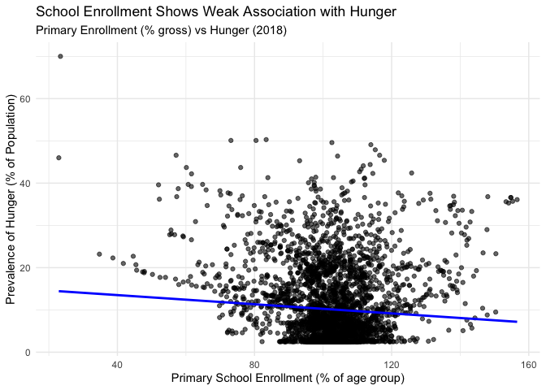
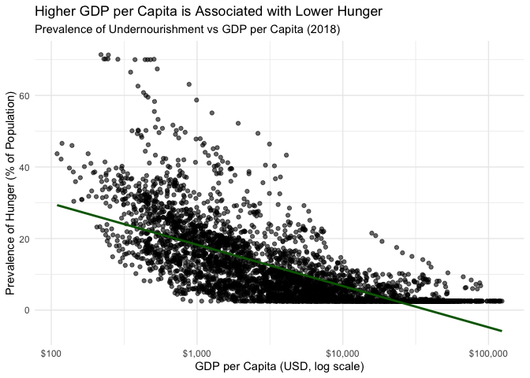
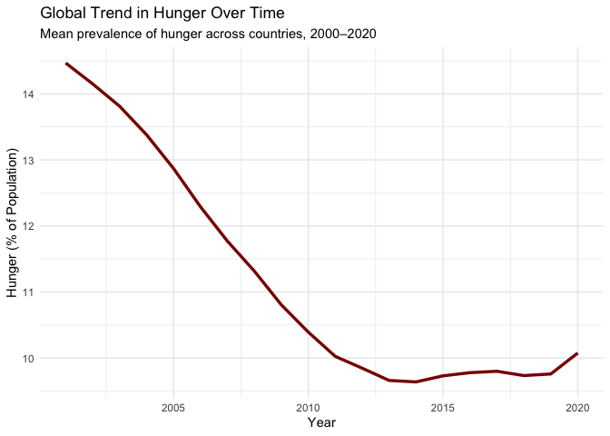
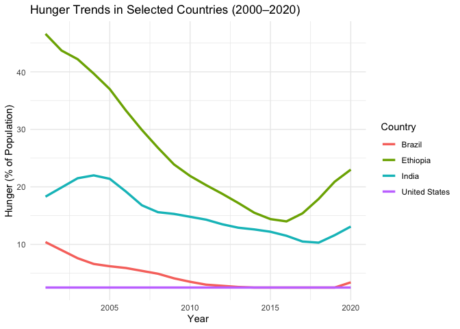
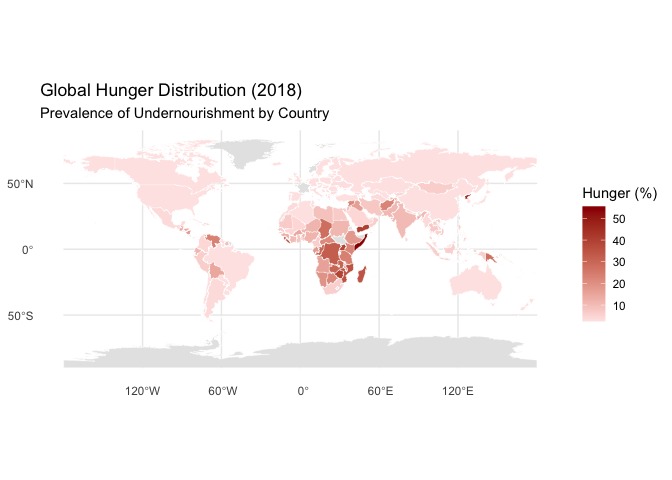

Understanding Global Hunger: A Data-Driven Analysis of Inequality,
Education, and Wealth
================
Nodir Uktamov

- [Introduction](#introduction)
- [Data Source & Cleaning](#data-source--cleaning)
  - [Data Source](#data-source)
  - [Cleaning & Preparation](#cleaning--preparation)
  - [Data Availability Check](#data-availability-check)
- [Exploratory Data Analysis](#exploratory-data-analysis)
- [Main Visualisations and Insights](#main-visualisations-and-insights)
  - [GINI Index vs Hunger](#gini-index-vs-hunger)
  - [School Enrollment vs Hunger](#school-enrollment-vs-hunger)
  - [GDP vs Hunger](#gdp-vs-hunger)
  - [Hunger Trends Over Time](#hunger-trends-over-time)
- [Discussion](#discussion)
- [Limitations](#limitations)
- [Recommendations for Future Work](#recommendations-for-future-work)
  - [Prioritise Data Collection in the Poorest
    Countries](#prioritise-data-collection-in-the-poorest-countries)
  - [Build Interactive Public-Facing Visual
    Platforms](#build-interactive-public-facing-visual-platforms)
- [Conclusion](#conclusion)
- [References](#references)

# Introduction

Hunger remains one of the most pressing ethical challenges of our time.
In many wealthy, developed countries, poverty is paradoxically
associated with overnutrition and diet-related illness, while in poorer
countries, children still go without enough food to support healthy
development. This stark inequality in food access and nutrition is not
just a humanitarian issue but also a structural and economic one.

This project explores the global prevalence of hunger and investigates
its association with key socioeconomic factors such as income inequality
(measured by the GINI index), primary school enrollment (as a proxy for
access to education), and GDP per capita. While it seems intuitive that
wealthier countries experience lower hunger, this project asks a deeper
question: To what extent do these variables explain hunger? Is one
factor more strongly associated than others, and are there exceptions?

To answer these questions, I sourced data from the World Bank covering
the years 2000–2020. After data wrangling, I focused the analysis on the
most recent year with the most complete data — 2018 — to maximise
country coverage in cross-sectional visualisations. For time-series
trends, I selectively examined countries with complete multi-year data.

This report begins with a description of the datasets used, followed by
exploratory data analysis and a series of visualisations, before
concluding with a discussion of the findings and their implications.

# Data Source & Cleaning

``` r
# Load required libraries
library(tidyverse)
library(sf)
library(rnaturalearth)
library(rnaturalearthdata)
library(naniar)
library(countrycode)
library(readr)
```

## Data Source

The dataset for this project was sourced from the [World Bank Open
Data](https://data.worldbank.org/), which provides publicly available
and regularly updated indicators for most countries globally. The
following four key indicators were selected for analysis:

- **Prevalence of Undernourishment (% of population)**  
  *Indicator Code:* SN.ITK.DEFC.ZS  
  This represents the percentage of the population whose food intake is
  insufficient to meet dietary energy requirements.

- **GINI Index (Income Inequality)**  
  *Indicator Code:* SI.POV.GINI  
  A measure of income distribution within a country, where 0 represents
  perfect equality and 100 represents maximal inequality.

- **Primary School Enrollment (% gross)**  
  *Indicator Code:* SE.PRM.ENRR  
  Gross enrollment ratio in primary education, regardless of age.

- **GDP per Capita (Current USD)**  
  *Indicator Code:* NY.GDP.PCAP.CD  
  The gross domestic product divided by midyear population, expressed in
  current US dollars.

All data was downloaded as `.csv` files and includes annual observations
from 2000 to 2020.

## Cleaning & Preparation

The data was cleaned and reshaped into long format to allow year-by-year
comparisons. Specifically:

- Only columns from 2000 to 2020 were retained for each indicator.
- Data was pivoted from wide to long format (`Year`, `Value` structure)
  for ease of merging and visualization.
- Country name, ISO country code, and year were used as identifiers for
  merging the four datasets.
- All numeric years were converted to integers for consistency.
- Leading and trailing `NA` rows were preserved until the point of
  visualization or correlation analysis to avoid unnecessary loss of
  valid data.
- When building plots or running correlations, only rows with complete
  values for the relevant indicators were retained using `drop_na()`.

This cleaning process ensured consistency across the datasets while
preserving the maximum number of observations.

``` r
# Load CSV files
hunger <- read_csv("data/API_SN.ITK.DEFC.ZS_DS2_en_csv_v2_2561.csv", skip = 4)
gini <- read_csv("data/API_SI.POV.GINI_DS2_en_csv_v2_2566.csv", skip = 4)
school <- read_csv("data/API_SE.PRM.ENRR_DS2_en_csv_v2_5690.csv", skip = 4)
gdp <- read_csv("data/API_NY.GDP.PCAP.CD_DS2_en_csv_v2_2702.csv", skip = 4)

# Define relevant years and columns
years <- as.character(2000:2020)
cols <- c("Country Name", "Country Code", years)

# Reshape to long format
hunger_long <- hunger %>%
  select(all_of(cols)) %>%
  pivot_longer(-c("Country Name", "Country Code"), names_to = "Year", values_to = "Hunger") %>%
  mutate(Year = as.integer(Year))

gini_long <- gini %>%
  select(all_of(cols)) %>%
  pivot_longer(-c("Country Name", "Country Code"), names_to = "Year", values_to = "GINI") %>%
  mutate(Year = as.integer(Year))

school_long <- school %>%
  select(all_of(cols)) %>%
  pivot_longer(-c("Country Name", "Country Code"), names_to = "Year", values_to = "SchoolEnroll") %>%
  mutate(Year = as.integer(Year))

gdp_long <- gdp %>%
  select(all_of(cols)) %>%
  pivot_longer(-c("Country Name", "Country Code"), names_to = "Year", values_to = "GDP") %>%
  mutate(Year = as.integer(Year))

# Merge the datasets into a single long-format dataframe
combined <- hunger_long %>%
  left_join(gini_long, by = c("Country Name", "Country Code", "Year")) %>%
  left_join(school_long, by = c("Country Name", "Country Code", "Year")) %>%
  left_join(gdp_long, by = c("Country Name", "Country Code", "Year"))

# Merge with map data to create a map
hunger_map_data <- combined %>%
  filter(Year == 2018) %>%
  select(`Country Code`, Hunger) %>%
  group_by(`Country Code`) %>%
  summarise(Hunger = mean(Hunger, na.rm = TRUE)) %>%
  rename(iso_a3 = `Country Code`)

# Load world map as an sf object
world <- ne_countries(scale = "medium", returnclass = "sf")

world_hunger_map <- left_join(world, hunger_map_data, by = "iso_a3")
```

## Data Availability Check

To assess the completeness of the data: - I counted the number of
missing values (`NA`) for each indicator across all countries and
years. - It was observed that data availability is uneven—lower-income
countries are less likely to have reported GINI and school enrollment
values. - Hunger and GDP data were more broadly available, making them
more reliable for global-scale analysis.

An example code used for checking missingness:

``` r
library(naniar)

hunger_long %>%
  group_by(`Country Name`) %>%
  summarise(
    MissingHunger = sum(is.na(Hunger)),
    MissingGINI = sum(is.na(GINI)),
    MissingEdu = sum(is.na(SchoolEnroll)),
    NYears = n()
  ) %>%
  arrange(desc(MissingHunger))
```

# Exploratory Data Analysis

Before performing statistical analysis or building visualizations, I
conducted an exploratory data analysis (EDA) to understand the
structure, availability, and general characteristics of the dataset. The
aim was to identify missing patterns, understand the distribution of
variables, and determine which countries and years could be included in
the analysis.

``` r
# Count missing values by variable
combined %>%
  summarise(
    Hunger_NA = sum(is.na(Hunger)),
    GINI_NA = sum(is.na(GINI)),
    SchoolEnroll_NA = sum(is.na(SchoolEnroll)),
    GDP_NA = sum(is.na(GDP))
  )
```

``` r
# Missingness pattern by year
combined %>%
  group_by(Year) %>%
  summarise(
    Hunger = sum(!is.na(Hunger)),
    GINI = sum(!is.na(GINI)),
    SchoolEnroll = sum(!is.na(SchoolEnroll)),
    GDP = sum(!is.na(GDP))
  ) %>%
  pivot_longer(-Year, names_to = "Variable", values_to = "Count") %>%
  ggplot(aes(x = Year, y = Count, color = Variable)) +
  geom_line(linewidth = 1) +
  labs(
    title = "Data Availability Over Time",
    y = "Number of Countries with Data"
  ) +
  theme_minimal()
```

<!-- -->
This figure shows the number of countries reporting data for each
indicator over time. GDP and hunger data are consistently available for
nearly all countries throughout the 2000–2020 period. School enrollment
also demonstrates strong coverage across years. However, the GINI index
(income inequality) has markedly lower and more variable coverage,
typically reported by fewer than 100 countries per year. This gap limits
the reliability of cross-country comparisons involving inequality,
particularly in low-income or politically unstable regions.

``` r
combined %>%
  filter(Year == 2018) %>%
  summarise(
    Hunger_mean = mean(Hunger, na.rm = TRUE),
    Hunger_sd = sd(Hunger, na.rm = TRUE),
    GINI_mean = mean(GINI, na.rm = TRUE),
    GINI_sd = sd(GINI, na.rm = TRUE),
    School_mean = mean(SchoolEnroll, na.rm = TRUE),
    School_sd = sd(SchoolEnroll, na.rm = TRUE),
    GDP_mean = mean(GDP, na.rm = TRUE),
    GDP_sd = sd(GDP, na.rm = TRUE)
  )
```

The average hunger prevalence across countries in 2018 was approximately
9.73%, with a standard deviation of 9.70, indicating a wide spread—some
countries have extremely high undernourishment while others report
almost none.

The mean GINI index was 35.7, suggesting moderate income inequality
globally, though a standard deviation of 6.64 reflects cross-national
variation.

Primary school enrollment averaged 101.1%, which is common for gross
enrollment ratios as they include overage students. However, the
standard deviation (~9.89) shows that some countries still lag
significantly.

The average GDP per capita was around \$17,589 USD, with a large
standard deviation of \$25,945, confirming a high level of global income
disparity.

``` r
combined %>%
  filter(Year == 2018) %>%
  pivot_longer(cols = c(Hunger, GINI, SchoolEnroll, GDP),
               names_to = "Variable", values_to = "Value") %>%
  ggplot(aes(x = Value)) +
  geom_histogram(bins = 30, fill = "skyblue", color = "white") +
  facet_wrap(~ Variable, scales = "free") +
  theme_minimal() +
  labs(title = "Distribution of Key Variables (2018)")
```

<!-- -->
Figure: Distribution of Key Variables (2018) This figure shows the
distribution of four main indicators used in this analysis for the year
2018.

GDP per Capita is heavily right-skewed, with most countries falling
below \$20,000. A small number of very high-income countries inflate the
upper tail. This motivates the use of a log scale in subsequent
GDP-related plots.

Hunger Prevalence also exhibits a right-skewed distribution. While many
countries report hunger below 10%, some still face undernourishment
rates exceeding 30–40%.

GINI Index is more uniformly distributed between 25 and 50, indicating
varied levels of income inequality across countries.

School Enrollment is tightly clustered between 95% and 105%, though
there are some countries with unusually low or even above-100% gross
enrollment rates, possibly due to over-age students being enrolled.

# Main Visualisations and Insights

## GINI Index vs Hunger

``` r
ggplot(combined %>% drop_na(GINI, Hunger), aes(x = GINI, y = Hunger)) +
  geom_point(alpha = 0.6) +
  geom_smooth(method = "lm", se = FALSE, color = "red") +
  labs(
    title = "Higher Income Inequality is Associated with Greater Hunger",
    subtitle = "GINI Index vs Prevalence of Undernourishment (2018)",
    x = "GINI Index (Income Inequality)",
    y = "Prevalence of Hunger (% of Population)"
  ) +
  theme_minimal()
```

<!-- -->
Interpretation: This scatterplot shows a moderate positive correlation
between income inequality and hunger prevalence. Countries with higher
GINI scores (more unequal) tend to report higher levels of
undernourishment. The trend line confirms this upward relationship,
supporting the idea that inequality may drive food insecurity.

## School Enrollment vs Hunger

``` r
ggplot(combined %>% drop_na(SchoolEnroll, Hunger), aes(x = SchoolEnroll, y = Hunger)) +
  geom_point(alpha = 0.6) +
  geom_smooth(method = "lm", se = FALSE, color = "blue") +
  labs(
    title = "School Enrollment Shows Weak Association with Hunger",
    subtitle = "Primary Enrollment (% gross) vs Hunger (2018)",
    x = "Primary School Enrollment (% of age group)",
    y = "Prevalence of Hunger (% of Population)"
  ) +
  theme_minimal()
```

<!-- -->
Unlike the GINI relationship, school enrollment has a very weak negative
correlation with hunger. Although statistically significant, the effect
size is small. This suggests that access to education, while important,
may not directly reduce food insecurity without addressing other
systemic factors.

## GDP vs Hunger

``` r
ggplot(combined %>% drop_na(GDP, Hunger), aes(x = GDP, y = Hunger)) +
  geom_point(alpha = 0.6) +
  geom_smooth(method = "lm", se = FALSE, color = "darkgreen") +
  scale_x_log10(labels = scales::dollar) +
  labs(
    title = "Higher GDP per Capita is Associated with Lower Hunger",
    subtitle = "Prevalence of Undernourishment vs GDP per Capita (2018)",
    x = "GDP per Capita (USD, log scale)",
    y = "Prevalence of Hunger (% of Population)"
  ) +
  theme_minimal()
```

<!-- -->
There is a strong negative association between GDP per capita and
hunger. The log scale helps spread out lower-income countries, showing
that as GDP increases, hunger prevalence tends to decrease sharply. This
supports the intuitive link between national income and food security.

These insights confirm that GDP and income inequality are more
meaningful predictors of hunger than school enrollment.

## Hunger Trends Over Time

Rationale:

``` r
# global average over time
ggplot(combined %>% drop_na(Hunger), aes(x = Year, y = Hunger)) +
  stat_summary(fun = mean, geom = "line", color = "darkred", size = 1.2) +
  labs(
    title = "Global Trend in Hunger Over Time",
    subtitle = "Mean prevalence of hunger across countries, 2000–2020",
    y = "Hunger (% of Population)",
    x = "Year"
  ) +
  theme_minimal()
```

<!-- -->
This line chart shows the overall trend in hunger over time. A decline
would indicate global progress, while stagnation or an increase might
point to persistent structural challenges.

``` r
ggplot(combined %>% 
         filter(`Country Name` %in% c("Brazil", "Ethiopia", "India", "United States")) %>%
         drop_na(Hunger),
       aes(x = Year, y = Hunger, color = `Country Name`)) +
  geom_line(size = 1.2) +
  labs(
    title = "Hunger Trends in Selected Countries (2000–2020)",
    y = "Hunger (% of Population)",
    x = "Year",
    color = "Country"
  ) +
  theme_minimal()
```

<!-- -->
To better understand how hunger evolves over time within different
economic contexts, I analysed trends in four countries: the United
States, Brazil, India, and Ethiopia. These countries represent a
spectrum from high-income to low-income settings. The results show stark
contrasts. In the United States, hunger levels remained consistently low
(around 2–3%) with virtually no change over the two-decade period,
reflecting economic stability and strong food infrastructure. Brazil, an
upper-middle-income country, also made steady improvements, reducing
hunger from around 10% in 2000 to approximately 2% by 2015.

In contrast, developing countries experienced both higher levels of
hunger and greater volatility. India showed a gradual decline in
undernourishment from 22% to about 10% over the period, but this
progress plateaued after 2015 and reversed slightly after 2018. Ethiopia
initially made remarkable progress, reducing hunger from nearly 50% in
2000 to under 15% by 2015. However, this gain was undone in recent
years, with undernourishment rising sharply again after 2018 — a pattern
that may reflect political instability, economic strain, or
climate-related shocks.

These country-level trends reinforce the broader conclusion that while
high-income countries are largely shielded from food insecurity,
developing nations remain vulnerable to both persistent and sudden
setbacks. This underscores the need for sustained investment in
resilience and food access systems, especially in low-income regions.

``` r
ggplot(world_hunger_map) +
  geom_sf(aes(fill = Hunger), color = "white", size = 0.1) +
  scale_fill_gradient(low = "#ffe6e6", high = "#990000", na.value = "grey90") +
  labs(
    title = "Global Hunger Distribution (2018)",
    subtitle = "Prevalence of Undernourishment by Country",
    fill = "Hunger (%)"
  ) +
  theme_minimal()
```

<!-- -->
Geographic disparities in hunger are made starkly visible when examining
country-level undernourishment data for 2018. The global pattern reveals
a heavy concentration of food insecurity in sub-Saharan Africa, where
many countries report hunger rates exceeding 30%, with some surpassing
50%. This contrasts sharply with regions such as North America, Europe,
and parts of East Asia, where undernourishment is minimal — typically
under 5%. Moderate levels of hunger are also observed in parts of South
Asia and Central America, where structural poverty and limited food
access persist despite economic growth.

Importantly, the global map also exposes gaps in data reporting. Several
countries, particularly in Africa and parts of Asia, are missing from
the dataset — a reflection not of the absence of hunger, but of
weaknesses in data infrastructure and reporting capacity. These
omissions highlight a critical limitation in global hunger monitoring:
some of the countries most likely to be affected by food insecurity are
also those least likely to be represented in the data. This dual
invisibility — of need and of evidence — underscores the urgency of
investing not only in food systems but in the basic statistical capacity
of lower-income nations.

# Discussion

### Correlation Summary

``` r
cor.test(~ GINI + Hunger, data = combined)
```

    ## 
    ##  Pearson's product-moment correlation
    ## 
    ## data:  GINI and Hunger
    ## t = 17.212, df = 1511, p-value < 2.2e-16
    ## alternative hypothesis: true correlation is not equal to 0
    ## 95 percent confidence interval:
    ##  0.3618585 0.4461629
    ## sample estimates:
    ##       cor 
    ## 0.4048708

``` r
cor.test(~ SchoolEnroll + Hunger, data = combined)
```

    ## 
    ##  Pearson's product-moment correlation
    ## 
    ## data:  SchoolEnroll and Hunger
    ## t = -4.3899, df = 3835, p-value = 1.165e-05
    ## alternative hypothesis: true correlation is not equal to 0
    ## 95 percent confidence interval:
    ##  -0.10212445 -0.03915465
    ## sample estimates:
    ##         cor 
    ## -0.07070999

``` r
cor.test(~ GDP + Hunger, data = combined)
```

    ## 
    ##  Pearson's product-moment correlation
    ## 
    ## data:  GDP and Hunger
    ## t = -31.464, df = 4340, p-value < 2.2e-16
    ## alternative hypothesis: true correlation is not equal to 0
    ## 95 percent confidence interval:
    ##  -0.4548891 -0.4064396
    ## sample estimates:
    ##        cor 
    ## -0.4309749

Summary: \* GINI vs Hunger: r = 0.40 → moderate positive, statistically
significant \* School vs Hunger: r = -0.07 → very weak, statistically
significant \* GDP vs Hunger: r = -0.43 → moderate negative,
statistically significant

The temporal trends indicate global progress in reducing hunger during
the early 2000s, followed by stagnation or reversal in some regions
post-2015. This may reflect new global challenges such as climate
shocks, conflicts, or economic crises. National trends in countries like
India or Ethiopia suggest that gains are fragile without sustained
development and resilience planning.

# Limitations

Data availability emerged as a significant limitation. Many low-income
countries lack reliable data on income inequality and education, which
may bias results toward wealthier, more data-rich nations. As a result,
the association between socioeconomic variables and hunger may be
underestimated or distorted. This highlights the importance of improving
global data infrastructure, especially in regions facing the most severe
food insecurity.

# Recommendations for Future Work

## Prioritise Data Collection in the Poorest Countries

One of the most pressing barriers to effective hunger analysis is the
lack of data from the countries that need the most help. As shown in
this report, many of the world’s lowest-income countries lack up-to-date
information on GINI, education, or even basic food security metrics.
Ironically, these are the same countries facing the highest rates of
hunger. Without accurate and consistent data, interventions risk being
misdirected or ineffective.

Recommendation: International agencies such as the UN, FAO, and World
Bank should prioritise investments in data infrastructure and
capacity-building in developing countries, particularly in sub-Saharan
Africa and parts of South Asia, where undernourishment affects more than
25% of the population.

## Build Interactive Public-Facing Visual Platforms

While this report is intended for academic purposes, hunger is not a
problem confined to academia. It is a moral crisis, as framed in the
article by Kılıç (2022), affecting one in nine people globally — most of
them children. Awareness and pressure for action must extend beyond
scientists and policymakers.

Recommendation: A future direction would be to design an interactive
web-based platform where users can scroll through a narrative map of the
world, seeing how hunger prevalence changes by country. As the reader
scrolls, the site would guide them through: Key statistics and
choropleth maps - The causes of hunger: inequality, lack of education,
conflict, and climate change - Personal stories or country spotlights
(e.g. Ethiopia saw a 5 percentage point rise after 2018 while the US
showed no fluctuation) - Actionable ways individuals and institutions
can contribute This approach aligns with the global need for accessible,
emotionally compelling communication that mobilises public empathy and
support.

# Conclusion

Hunger remains one of the most urgent and ethically troubling challenges
facing humanity. While global averages show improvement over the last
two decades, this progress is neither universal nor stable. As shown in
this report, income inequality and GDP per capita are significant
predictors of hunger prevalence across countries. In contrast, education
access, while important, shows only a weak statistical relationship,
highlighting that food insecurity is a structural economic issue more
than an educational one.

Spatial analysis revealed that hunger is heavily concentrated in the
Global South, particularly in sub-Saharan Africa and parts of South
Asia, where prevalence rates exceed 25% in some countries. Time trend
analysis showed that while high-income countries like the United States
experienced little change in hunger rates, countries like Ethiopia saw a
5 percentage point increase after 2018 (from 17.9% to 23.0% by 2020),
possibly linked to conflict, inflation, or climate shocks.

This analysis also underscored the need for better data: many of the
world’s poorest countries—the ones facing the highest hunger burdens—are
underrepresented in global datasets, limiting both visibility and
response. This points to a deeper injustice: those most in need of help
are often excluded from the data, and therefore from global
decision-making.

Addressing global hunger requires not only economic development, but
also fairer wealth distribution, improved data access, and public
engagement. Future work should include public-facing, interactive visual
platforms to raise awareness among wider audiences and push for action
beyond scientific and policy circles.

Hunger is not inevitable. But to end it, the world must be willing to
look at it—not just where it is easy, but especially where it is hidden.

# References

- Kılıç, R. (2022). The problem of hunger in the world and a new model
  proposal to solve this problem. Balkan Sosyal Bilimler Dergisi,
  11(21), 63-68.
